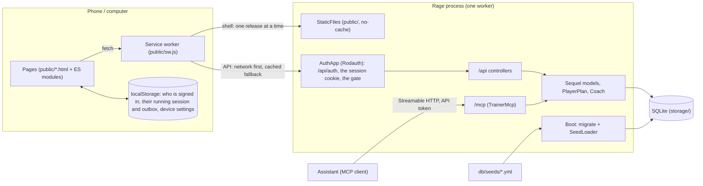

# Architecture

One process, one SQLite file, one static PWA, and an MCP server for an
assistant acting as a personal trainer. Everyone signs in with a username
and password; the install's first account, its owner, is made with a
one-time setup code from the server's log, and the owner invites everyone
else.

## Server

- **Rage** (`config/application.rb`, `config.ru`): Rails-style controllers, a
  fiber per request, on Rage's own server. `lib/static_files.rb` serves
  `public/` in front of the app with `Cache-Control: no-cache` and a
  Content-Security-Policy that runs only this origin's scripts and lets no
  other site frame the app. The API reference page (`lib/api_reference.rb`)
  serves an exact Swagger UI release kept in `lib/api_reference/swagger-ui`
  (its `package.json` says which), under its own CSP, and Rage's OpenAPI
  document at `/api/openapi/json`. Iodine takes request bodies of 1 MB at
  most (`config/initializers/request_limits.rb`), and in production the log
  is Rage's JSON lines with the path and messages escaped
  (`lib/log_formatter.rb`), so a client can't add fields to a line. New
  files the app writes are its user's only (umask 077), and other users of
  the machine can't read the database (`Database.keep_private`).
- **Accounts and sign-in** (`lib/auth_app.rb`, `lib/auth/`, `config/initializers/sign_in.rb`):
  [Rodauth](https://rodauth.jeremyevans.net) as Roda middleware inside
  Rage's stack, on the app's own Sequel connection. Roda's encrypted session
  cookie (`__Host-lazy_runner`, or `lazy_runner` with `SECURE_COOKIES=false`
  for plain http) is sealed with `SESSION_SECRET` or `storage/session_secret`
  (`lib/secrets.rb`), lasts 90 days from the last visit and a year at most,
  and each sign-in is a row in `account_active_session_keys`, so a device can
  be signed out from another. `AuthApp` answers `/api/auth/*` (sign in, sign
  out, create an account with the setup code or an invite, change the
  password) and stands in front of
  everything else under `/api` with its gate (`lib/auth/gate.rb`): a write
  must come from the app's own origin (`Sec-Fetch-Site`, else `Origin`) with
  a JSON body (`lib/auth/csrf.rb`), and what each route needs is a row in
  `Auth::Access::RULES` (`lib/auth/access.rb`, a test fails for a route
  without one): a request without a session is a 401, except `/api/version`,
  `/api/openapi` and `/api/me`, and the account, users and invites need a
  signed-in browser. What it lets through carries the user's id;
  `ApplicationController` sets `Current.user` from it. Passwords are
  Argon2id, hashed on two threads of their own (`lib/hashing.rb`) so a
  sign-in doesn't hold up other requests; ten wrong ones lock the account
  for 15 minutes, and attempts are
  throttled per username (`lib/throttle.rb`, `lib/auth/throttles.rb`). An unknown username costs a
  dummy hash, so its answer takes as long; past 60 a minute it waits that
  long instead, so made-up usernames can neither keep real users out nor
  keep the worker hashing. A throttle holds the latest 10,000 usernames,
  so a flood can't grow it either. While there are no
  users, the boot logs a setup code (`lib/setup_code.rb`) that creates the
  owner on the setup screen, and `rake users:create_owner` from a shell
  (`lib/tasks/users.rake`). There `rake users:reset_password` gets anyone
  back in, the owner included, with a temporary password
  (`User#temporary_password!`), and `rake users:list` names them. The owner invites
  the others (`Invite`: a one-time link, `/signin.html#invite/<token>`, in
  the fragment so no log records it, for 7 days, kept as a digest and used
  up in the transaction that makes the account), and resets a password to
  a temporary one (`User#reset_password!`), which leaves the user nothing
  but `/api/me` and changing it (`ApplicationController#password_chosen!`).
  Removing a user removes their data: every per-user table cascades from
  `users`. With `OIDC_ISSUER` set (`lib/oidc.rb`), an OpenID Connect
  provider is another way into the same accounts: `rodauth-omniauth` and
  `omniauth_openid_connect` run the authorization code flow with PKCE, a
  state and a nonce, and `Auth::OidcCallback` signs in the user the identity is linked
  to (`user_identities`, by issuer and `sub`, never by a username or email
  the provider gives), joins with an invite, links it to the signed-in user
  (Settings → Account), or, with `OIDC_AUTO_SIGNUP`, makes an account. A
  device signed in that way names the identity, so unlinking it also signs
  out the other devices that used it and revokes the API tokens made on
  them (`UserIdentity#unlink!`). The
  callback is a plain GET from the provider's site, which the `SameSite=Lax`
  cookie allows. Assistants and scripts sign
  in with personal API tokens (`ApiToken`, made in Settings): the gate
  takes `Authorization: Bearer` on `/api` in place of the session for a
  token with REST access (`scope: api`; the default is MCP alone), and
  `/mcp` takes tokens only, through the mcp gem's `token_verifier`
  (`TrainerMcp::TokenVerifier`, read the same way for both in
  `lib/auth/token.rb`), which hands each tool its user.
- **Data per user**: every personal table has a `user_id` (see
  [data-model.md](data-model.md)), and the models read the user from
  `Current.user` (`ApplicationController` sets it for a request, and
  `TrainerMcp::Tool` for a tool call). Scoping is the default, not
  something a query asks for: a per-user model's dataset (`Record.per_user`)
  carries `user_id = <the signed-in user>`, worked out as each query is
  made, so `Session.find!(id)`, an association or an eager load all keep to
  that user, and any of them raises `Current::Missing` when nobody is signed
  in rather than reading everyone's. Blocks, steps and completions are
  scoped through their parent (`workout_id IN (the user's workouts)`), and
  saved or deleted only while that parent is the user's (`Record::OwnParent`);
  a set log's step, a plain link, must be the user's too.
  Opting out is explicit and rare: `Model.everyone` (the seed loader's
  maintenance, finding an API token by its secret) and `Model.of(user_id)`.
  Model code reads the user only from `Current`; code working on someone
  else's records runs as them (`Current.set(user:)`), and saving or deleting
  a record while another user is signed in raises `Current::Mismatch`. A
  record's own update, delete and refresh name its `user_id`, and the
  composite foreign keys refuse a link to another user's record. In tests,
  a query a request makes on a per-user table without `user_id` fails the
  test (`UserScopeTripwire` in `test/test_helper.rb`). A new account starts
  with nothing of its own: they set their gear and import example programs.
- **Example programs** (`db/examples/*.yml`, `app/models/example.rb`): not
  stored until a user imports one (`POST /api/examples/:slug/import`, MCP
  `import_example`), which copies it into an ordinary program of theirs,
  each step's weight snapped to the nearest one they own of its gear. The
  list marks each piece of gear the user owns and counts the exercises that
  need gear they lack (`missing_exercises`), so the best fit goes first.
- **Controllers** (`app/controllers/api/`): one per resource, all JSON. The
  shared error shape lives in `application_controller.rb`, which also
  settles the request's today (`Current.today`: the device's `today` within
  a day of the server's, else the server's). Each action's comment is its OpenAPI
  description, see [api.md](api.md).
- **MCP server** (`app/mcp/`): the official `mcp` gem's Streamable HTTP
  transport, mounted at `/mcp` in the same process (`config/routes.rb`),
  stateless and answering in plain JSON. `TrainerMcp` holds the server, the
  trainer brief (`trainer_mcp/brief.md`, sent as the server's instructions and
  also offered as a prompt and a resource) and the tools, which call the
  models directly and answer in compact JSON. The write tools share the
  API's model code (`WorkoutStructure`, `Session.plan_all!`, `DateRange`,
  `ExerciseWeight.remember!`), so both refuse the same things. See [api.md](api.md#mcp-server).
- **Models** (`app/models/`): Sequel models of the tables (see
  [data-model.md](data-model.md)), sharing `Record`'s plugins and validation
  wording, plus plain objects for the logic:
  `PlayerPlan` flattens workouts into the screens the player walks through,
  `Coach` reads the stepper's increments from `config/coach.yml`, `Weights` converts, snaps and compares weights, `SessionDetail`
  and `ExerciseHistory` shape history, `WorkoutStructure` writes a
  workout's blocks and steps in one go (the builder API, and MCP through
  `Workout.create_with!` and `Workout#revise!`), `Release` digests `public/`.
- **Database** (`lib/database.rb`): one SQLite connection shared by the
  request fibers in turn, with a write-ahead log, foreign keys, IMMEDIATE
  transactions and a busy handler that yields to other fibers.
- **Boot** (`config/initializers/database.rb`): migrates the schema (Sequel
  timestamp migrations, taking over a database ActiveRecord migrated up to
  0.1.0; an existing database with migrations due is first copied to
  `storage/backups/`, the newest five kept) and runs `SeedLoader`, which loads equipment and exercises
  from YAML idempotently, then closes the connection. `TZ` sets the day (`config/initializers/time_zone.rb`).

## Frontend

Plain ES modules in `public/js/`, no framework, no build step. Pages:
`index.html` (Today, Workouts, History, a workout, the player, by URL hash),
`calendar.html` (a week, or a month from the tablet tier, with sessions,
activities and the coach's notes on its days), `coach.html` (what is new or waits for an answer as a band, the
status, focus and open concerns as one card, goals and this week as seven
days of tiles opening the Calendar, and the notes as a timeline, two
columns in landscape; `coach-page.js`, sheets in
`coach-sheets.js`, shared with the Calendar), `library.html`
(exercises), `equipment.html`, `settings.html` (five sections, each with its own
address: `#training`, `#account` with sign-out, the password and signed-in
devices, `#people` for the owner's users and invites, `#coach` with API
tokens and MCP, `#about`; a card's id opens its section), `signin.html` (sign in, set up a fresh install, join with an
invite, leave a temporary password) and `welcome.html` (a first sign-in:
units, gear, example programs and training days, which become weekly
routines; counted as seen once it shows, and `/api/me` says `welcomed`).
What is left of set-up is Today's "Getting set up" card
(`/api/account/setup`), until done or hidden. `nav.js` draws the navigation from `routes.js`
and asks `/api/me` who is signed in, sending a signed-out device to the
sign-in page. What a device keeps of a user's (the outbox, a running session,
the unit copy, the service worker's API copies) is theirs: `account.js`
remembers whose it is and forgets it when someone else signs in or on sign
out, and the outbox only sends a change while the user who made it is
signed in. Every write goes through `send` in `api.js` or the outbox, so
each carries what the CSRF check wants.

Markup is written only in `html` tagged templates (`html.js`): each value is
escaped unless it is html itself (a nested template, or what `icon`,
`inLine` and `joined` build), and a list is taken item by item, so it stays
html. Nothing else makes html: there is no way to vouch for a string.
Assigned to `innerHTML`, a template is its text. A test reads every module
for markup or an attribute outside html``, and for html added or joined into
a string; the browser test fails when markup or a character reference shows
as text.

Logic is kept out of the DOM so node can test it (`test/js`): `player.js`
and `countdown.js` (the session state machine and timers), `workout.js`,
`builder.js` (the workout editor's draft and the request that saves it),
`weights.js`, `history.js`, `calendar.js` (weeks, statuses, and queued
changes laid over the server's answer), `activities.js` (sport icons,
distances and times, activity requests and their queued overlay, when Today
asks how hard one was, the km/mi copy), `routines.js` (what a routine is
called, how a day of it reads on the device's today, queued activities that
tick a day off, the routine form and its requests), `coach.js` (who wrote a note, the
week as days, the journal's filters, the note and goal forms and their requests), `plan-changes.js`
(what an agent's change to the plan says on the calendar, and the undo
request), `coach-news.js` (Coach's "Since you last looked", grouped by
agent, each change with its reason), `week.js` (how a week adds up: planned against
done by kind, distance sums), `unit-setting.js` (the lb/kg and km/mi settings and this
device's copy of each), `catalog.js`, `inventory.js`, `gear.js` (owned and
missing gear, what an item unlocks, how an example fits), `figure.js`
(animation keyframes), `outbox.js`, `session-log.js`, `run-store.js`,
`offline.js`, `preferences.js`, `routes.js`, `setup.js` (the set-up card's
rows, the welcome's week plan), `api.js`, `account.js`. The rest (`app.js`,
`editor.js`, `library.js`, `figure-view.js`, ...) renders.

## A session, end to end

1. Today asks `GET /api/today`: the day's workout, framed with its warm-up and
   cool-down, already flattened into player items with resolved targets.
2. The player runs entirely in the browser. The running session is saved in
   localStorage after every step (`run-store.js`), so a reload, an app switch
   or a dead connection loses nothing.
3. Every write goes through the **outbox** (`outbox.js`): an ordered queue in
   localStorage, flushed in order whenever the network allows. The session is
   created with a `client_ref`, and later requests name it as `{ref}` until
   the server gives it an id, so sets and the finish can be logged offline.
   Retries are safe: sessions by `client_ref`, sets by their unique key.
   A change the server keeps failing on (three 500 `server_error` answers
   while `/api/version` answers, each within an hour of the last) is parked
   with the ones that build on it, so the rest carries on; Today says so, and
   Settings, Account lists it with Try again and Discard. A proxy's 502/503/504
   and the app's 503 `unavailable` (a locked or full database) are waited out
   like an outage.
4. `POST /api/sessions/:id/complete` stores the finish (RPE, how the weights
   felt, a note) for the user and the coach agent to go by; the app changes
   no weight from it.

## Offline and releases

`public/sw.js` keeps the app shell as one cache per **release**, the digest of
`public/` that `GET /api/version` returns, so a page never mixes modules from
two versions. A new release is fetched whole in the background and used from
the next load. API reads are network first; the last 200 good answers are the
offline fallback (one asked on another day falls back to the last copy
without its `date` or `today`), and `getJson` (`api.js`) says when an answer
came from the cache. Writes bypass the worker and wait in the outbox, but
for coach notes, goals and routines, which are sent straight away and say
so while offline (`NEEDS_CONNECTION`).

The whole app opens offline because the pages **fetch ahead**: once a page
knows the user is signed in and online, and the worker controls it, it
asks (on a new day and at most every 30 minutes, never mid-session,
`fetchAhead` in `offline.js`) for every workout (its view and Today's start
of it), this week and this month on the calendar, what is up next, the coach
board, history, settings, exercises and equipment. It stops on a slow or
missing server, a sign-in or a session starting, and tries again two
minutes later. Each address comes from
`paths` in `api.js`, which the pages use too, so the worker's copy answers
what the page asks later. A page with no copy says so in words
(`loadProblem`), and the navigation shows one quiet "Offline" note with the
changes waiting while the device is offline or the server is out of reach.
The copies are one user's: they go on a sign-out, a switch of user and when
`/api/me` says nobody is signed in (`checkSignedIn`); the outbox and a
session under way stay until someone else signs in.

Installed on an iPad or iPhone, the app opens on its own background in
either scheme: Safari takes the startup image from the page as it is added
to the Home Screen, so `pwa.js` draws one for the screen it is on. Pages ask
the browser to keep their data (`navigator.storage.persist()`), and Settings
recommends Add to Home Screen in a browser tab, where Safari clears a site's
data after seven days without a visit.

Offline and signed out are told apart by `GET /api/me` (`whoIsSignedIn` in
`account.js`), read without following redirects: the app's own 401 is signed
out; a redirect or another sign-in challenge (401, 407) is a sign-in in
front of the app (`gate`); anything else short of an answer is offline. A page that
meets either goes to `/signin.html` (with `?gate`, which the worker loads
from the network first so a proxy's redirect reaches the browser). An
offline page asks again when it comes back on screen or the connection
returns, the sign-in page offers Try again, and Settings can sign out on the
device alone when the server can't be reached; `checkSignedIn` then ends the
server's sign-in the next time it answers, rather than taking it up again.

## Build, test, deploy

- **CI** (`.github/workflows/ci.yml`, GitHub-hosted runners): tests only, as
  parallel jobs: Ruby tests, node tests and a Playwright run against the real
  server (offline finish included).
- **Release** (`.github/workflows/release.yml`): once CI passes on main,
  release-please keeps a release PR open with the next version and changelog
  from the conventional commits. When CI passes on the merged release PR, it
  tags and publishes the GitHub release, and the same run builds the
  image natively for amd64 and arm64, each on a GitHub runner of that
  architecture in parallel, pushes each by digest and joins them into one multi-arch
  image in the GitHub container registry, tagged with the version (`1.2.3`
  and `1.2`) and `latest`. Run by hand with a
  release tag, it builds that release again (moving `latest` and `1.2` only when asked).
- **Version**: the release workflow passes release-please's version and the
  commit's short sha to the image build (`APP_VERSION`, `APP_COMMIT`), and
  `AppVersion` reads them back; any other build is `dev`, with the sha of its
  git checkout. `GET /api/version` returns both, and Settings shows them.
- **Image** (`Dockerfile`): Ruby version from `.ruby-version`, runs as a
  non-root user, data in the `/app/storage` volume, health check on
  `/api/version`. To run it, see [Running it](../README.md#running-it).
- Hosting specifics (proxy, sign-in, hostnames) stay outside this repository.
