# Data model

One SQLite file (`storage/<env>.sqlite3`, or `DATABASE_URL`), migrated on
every boot by Sequel from `db/migrate/`. Every table but the two join tables
(`exercise_equipment`, `step_equipment`) and Rodauth's `account_*` tables
also has `created_at` and `updated_at`, left out below. `test/lib/docs_test.rb` checks that every table and column appears here.

The exercise library and the equipment catalogue are shared and seeded.
Everything else is one user's: a `user_id` (deleted with the user) on every
personal table, or a parent that has one (blocks and steps through their
workout, completions through their session). Links between two of a user's
records are composite foreign keys on `(user_id, id)`, so a session can't
name another user's workout even by mistake. The diagram leaves the
`users` links to these tables out. `invites` stand alone: an owner's
links for others to join.

```mermaid
erDiagram
    equipment ||--o{ exercise_equipment : "needed by"
    exercises ||--o{ exercise_equipment : needs
    equipment ||--o{ step_equipment : "used by"
    steps ||--o{ step_equipment : uses
    programs |o--o{ workouts : groups
    workouts |o--o{ workouts : "warm-up / cool-down"
    workouts ||--o{ blocks : has
    blocks ||--o{ steps : has
    exercises ||--o{ steps : "done in"
    workouts ||--o{ sessions : "run as"
    sessions ||--o{ set_logs : logs
    steps |o--o{ set_logs : "planned by"
    exercises ||--o{ set_logs : "done / planned"
    sessions ||--o| completions : "finished by"
    exercises ||--o| exercise_weights : remembers
    exercises ||--o{ weight_suggestions : "suggested for"
    sessions ||--o{ weight_suggestions : suggests
    sessions |o--o{ weight_suggestions : supersedes
    users ||--o{ activities : logs
    users ||--o{ goals : "aims for"
    goals |o--o{ goals : "proposed to replace"
    users ||--o{ coach_notes : "coached in"
    activities |o--o{ coach_notes : "noted on"
    sessions |o--o{ coach_notes : "noted on"
    users ||--o{ routines : "means to"
    workouts |o--o{ routines : "run by"
    routines ||--o{ routine_days : "changed on"
    routines |o--o{ sessions : "confirmed as"
    routines |o--o{ activities : "linked by hand"
    users ||--o| account_password_hashes : "proves with"
    users ||--o| account_login_failures : "failed sign-ins"
    users ||--o| account_lockouts : "locked by"
    users ||--o{ account_active_session_keys : "signed in on"
    users ||--o{ api_tokens : "lets in"
    users ||--o{ user_identities : "signs in as"
    user_identities |o--o{ account_active_session_keys : "signed in"
    user_identities |o--o{ api_tokens : "made under"
    users ||--o{ user_equipment : owns
    equipment ||--o{ user_equipment : "owned as"

    equipment {
        int id PK
        string slug UK
        string name
        int position
        string unit "lb | kg | null: whether it comes in set weights"
        bool any_weight "the generic weight: any owned gear in set weights stands in"
        bool retired "dropped from the seeds, kept for users who had it"
    }
    user_equipment {
        int id PK
        int user_id FK
        int equipment_id FK "unique per user"
        bool owned "no row: not owned"
        json weights "owned weights, for fixed-weight gear"
        string unit "lb | kg, once set or weights are listed; null: follows settings.unit"
    }
    exercise_equipment {
        int id PK
        int exercise_id FK
        int equipment_id FK
    }
    exercises {
        int id PK
        string slug UK
        string name
        string category "stretch | mobility | activation | strength | cardio"
        json areas "legs, hips, core, upper_body"
        string pattern "squat, lunge, hinge, push, pull, ..."
        json cues
        json mistakes
        json instructions
        bool unilateral
        bool alternating "sides in turn within a set; reps count both"
        int weights_held "1, or 2 for a dumbbell in each hand"
        int default_reps
        int default_seconds
        json animation "keyframes, see public/js/figure.js"
        bool retired "dropped from the seeds, kept for logged sets"
    }
    programs {
        int id PK
        int user_id FK
        string example_slug "the example it was imported from"
        string name
        text description
        string source "user | llm"
    }
    workouts {
        int id PK
        int user_id FK
        int program_id FK "null for one standing alone"
        string example_slug "the example workout it was imported as"
        string kind "warmup | workout | cooldown"
        string title
        string subtitle
        int position
        string source "user | llm"
        int warmup_id FK
        int cooldown_id FK
        bool no_warmup
        bool no_cooldown
        datetime archived_at "deleted = archived"
    }
    blocks {
        int id PK
        int workout_id FK
        string label "A, B, Warm-up; unique per workout"
        int position
        int rounds
        int rest_seconds "after each round but the last"
    }
    steps {
        int id PK
        int block_id FK
        int exercise_id FK
        int position
        int reps "reps or duration_seconds, not both"
        int duration_seconds
        string tempo "3 or 4 digits, such as 3110"
        decimal weight_value "the step's own target"
        string weight_unit
        int weights_held
        bool per_side
        string note
    }
    step_equipment {
        int id PK
        int step_id FK
        int equipment_id FK
    }
    sessions {
        int id PK
        int user_id FK
        int workout_id FK
        date date
        int position "order within the day, 1 first"
        string status "planned | in_progress | done | skipped; missed is derived"
        string created_by "seed | manual | llm"
        string agent_name "the agent's API token name, when llm"
        text note "the planner's reason for it"
        datetime started_at
        json part_kinds "the parts it runs: warmup, workout, cooldown"
        string client_ref UK "per user; makes POST /api/sessions safe to retry"
        int routine_id FK "the routine day it confirms; null when the routine goes"
        date routine_date "that routine's own day, unique with it"
    }
    set_logs {
        int id PK
        int user_id FK "the session's, for history by exercise"
        int session_id FK
        int step_id FK "nulled when the step leaves"
        int step_ref "the step logged against, kept"
        int exercise_id FK "done (differs when swapped)"
        int planned_exercise_id FK
        string block_label
        int set_number
        string side "left | right | null"
        string status "done | skipped"
        int reps
        int seconds
        decimal weight_value
        string weight_unit
        int target_reps
        int target_seconds
        decimal target_weight_value
        string target_weight_unit
    }
    completions {
        int id PK
        int session_id FK,UK
        datetime finished_at
        int rpe "1-10"
        string feedback "too_easy | right | too_hard"
        text note
        bool ended_early
    }
    exercise_weights {
        int id PK
        int user_id FK
        int exercise_id FK "unique per user"
        decimal value "null: no weight"
        string unit
    }
    weight_suggestions {
        int id PK
        int user_id FK "the session's"
        int exercise_id FK
        int session_id FK
        string direction "up | down"
        decimal value
        string unit
        string reason
        string status "pending | accepted | dismissed | superseded"
        int superseded_by_id FK "the session whose finish superseded it"
    }
    activities {
        int id PK
        int user_id FK
        date date "the sender's own day it started on"
        datetime started_at "UTC"
        string sport "free text, trimmed and lowercase"
        string title "null: the sport is shown"
        int moving_seconds
        int elapsed_seconds
        int distance_m "metres"
        int climb_m "metres"
        int avg_hr
        int max_hr
        int rpe "1-10, the person's"
        text note
        string source "with external_id, unique per user"
        string external_id "its id at the source"
        string client_ref UK "per user"
        string created_by "manual | llm"
        string agent_name "the agent's API token name, when llm"
        int routine_id FK "a sport routine's day it was linked to by hand"
        date routine_date "that day, unique with the routine"
    }
    routines {
        int id PK
        int user_id FK
        string title "null: the sport or workout is shown"
        string sport "a sport, or workout_id"
        int workout_id FK "one of the user's workouts"
        json weekdays "ISO 1-7; empty for a one-off"
        date starts_on
        date ends_on "a one-off's is its day; null runs on"
        int minutes "rough"
        int distance_m "rough, metres"
        string effort "easy | moderate | hard"
        text note
        string created_by "manual | llm"
        string agent_name "the agent's API token name, when llm"
    }
    routine_days {
        int id PK
        int routine_id FK
        date date "the routine's own day, unique with it"
        string status "confirmed | skipped | moved"
        date moved_to "the day it shows on instead"
    }
    goals {
        int id PK
        int user_id FK
        string title
        text why
        date target_date
        string status "active | achieved | dropped | proposed | dismissed"
        int position "an active goal's place, 1 first"
        string created_by "user | llm (proposed)"
        string agent_name "the agent's API token name, when llm"
        text proposed_reason "an agent's reason"
        int replaces_id FK "the goal a proposal would change"
        datetime decided_at
    }
    coach_notes {
        int id PK
        int user_id FK
        string kind "status | focus | concern | note"
        string title
        text body
        string author_kind "user | human | llm"
        string author_name "a human coach's name, or the agent's API token name"
        date date "the day it is about"
        int activity_id FK "set null when deleted"
        int session_id FK "set null when deleted"
        datetime resolved_at "a concern's"
        text resolution
    }
    settings {
        int id PK
        int user_id FK,UK
        string unit "lb | kg"
        string distance_unit "km | mi"
    }
    users {
        int id PK
        string username UK "case-insensitive, 3-40 characters"
        bool owner "made the install"
        bool password_change_required "signed in with a temporary password"
        datetime welcomed_at "finished or skipped the welcome screen"
    }
    account_password_hashes {
        int id PK,FK "the user"
        string password_hash "Argon2id"
    }
    account_login_failures {
        int id PK,FK "the user"
        int number "wrong passwords in a row"
    }
    account_lockouts {
        int id PK,FK "the user"
        string key "unused: no unlock by email"
        datetime deadline "locked until"
        datetime email_last_sent "unused"
    }
    user_identities {
        int id PK
        int user_id FK
        string issuer UK "the OIDC provider (with subject, unique)"
        string subject "its sub for the person"
        string username "what the provider calls them"
        datetime last_used_at
    }
    api_tokens {
        int id PK
        int user_id FK
        string name "what it is for"
        string digest UK "SHA-256 of the token, shown once"
        datetime last_used_at "to the minute"
        int user_identity_id FK "made on a device signed in with it, if any"
    }
    invites {
        int id PK
        string digest UK "SHA-256 of the token, shown once"
        datetime expires_at "7 days on; used or revoked, it is deleted"
    }
    account_active_session_keys {
        int id PK
        int account_id FK "the user"
        string session_id "HMAC of the cookie's key"
        string device "user agent at sign-in; signed in at created_at"
        datetime last_use
        int user_identity_id FK "the identity it signed in with, if any"
    }
```

## Six groups

- **Accounts:** `users`, and Rodauth's tables for signing in (`lib/auth_app.rb`):
  the password hash, kept apart so a query on users never carries one; wrong
  passwords in a row and the lockout they lead to; and one row per signed-in
  device. `user_identities` are the identities at the install's OpenID
  Connect provider that sign a user in (one per user and provider): a user
  has a password, an identity or both. A device signed in with one names
  it, as does a token made there, so unlinking the identity signs that
  device out and revokes the token.
  `api_tokens` let an assistant or a script in as the user (revoking deletes one).

- **Inventory:** the `equipment` catalogue, and what each exercise needs
  (`exercise_equipment`). An exercise with none is bodyweight. Steps can name
  extra gear (`step_equipment`). What a user owns, and which weights, is
  `user_equipment`.
- **Plan:** `programs` → `workouts` → `blocks` → `steps`, all the user's: a
  program is an example they imported (`db/examples`, copied on import), and
  a workout belongs to one or stands alone. A block is a circuit:
  every round runs its steps in order, per-side steps left then right.
  A main workout is framed by a warm-up and a cool-down: its own choice
  (`warmup_id` / `cooldown_id`, or none with `no_warmup` / `no_cooldown`),
  else its program's.
- **Log:** `sessions` → `set_logs` and one `completion`. A set log is
  self-contained (exercise planned and done, block, target), so history
  survives edits to the plan and swaps in the player.
- **Activities:** `activities`, runs and other sports as they happened, with
  the numbers as they were sent and nothing worked out from them. They sit
  beside sessions on the calendar.
- **Routines:** `routines`, what the user means to do, tentatively: a sport or
  a workout, weekly or once. Their days are worked out when the calendar is
  read (`RoutineCalendar`); `routine_days` holds only the days the user
  changed, a workout routine's confirmed day is a planned session naming it,
  and an activity can be linked to a day by hand.
- **Coach board:** `goals` (what the user trains for; only they write active
  ones, an agent proposes) and `coach_notes` (status, focus, concerns and a
  journal, by the user, a coach they name, or an agent). The current status
  or focus is the newest note of its kind; nothing marks which replaced which.
- **Coach state:** `exercise_weights` (the remembered weight per exercise, which
  wins over a step's own weight in every workout), `weight_suggestions` (a
  step up or down after a session, until confirmed or declined) and `settings`.

## Who owns what

| Data | Comes from | Notes |
|------|-----------|-------|
| Exercises and the equipment catalogue | `db/seeds/*.yml`, loaded by `lib/seed_loader.rb` on every boot, shared | Matched by slug, updated in place so ids stay stable. |
| Programs and their workouts | Imported from `db/examples/*.yml` (`POST /api/examples/:slug/import`, MCP `import_example`), weights snapped to the user's gear | The user's from then on, like any workout of theirs; `example_slug` notes the example. Nothing is seeded. |
| `user_equipment` | The user, on the Equipment page | A new account owns nothing. |
| Workouts (`source: user` or `llm`) | Imported, duplicated, or built with `POST /api/workouts` (MCP marks its own `llm`) | Archived, never deleted. `PUT` rewrites their blocks and steps, keeping the step ids it names; steps it drops go, their logged sets stay. |
| Sessions, set logs, completions, weights, suggestions, settings | The app, per user | Never touched by the seed loader. A logged set is never deleted by it. |
| Goals | The user, in the app | An agent only proposes one (MCP `propose_goal`): `proposed` until the user accepts or dismisses it; dismissed ones stay so it isn't proposed again. |
| Coach notes | The user or a coach they name in the app; an agent through MCP (`author_kind: llm`) | The agent changes, deletes and resolves only its own notes (at most 20 new a day); the app doesn't change an agent's note, but deletes it. |
| Activities | The app, or a script through `POST /api/activities`, or an agent through MCP `log_activities` (`created_by: llm`) | One from elsewhere is matched by `source` + `external_id` and updated in place; the person's `rpe` and `note` are never overwritten by a resend. |
| Routines | The app, or an agent through MCP (`created_by: llm`) | The agent changes and ends only its own, and never confirms, skips or moves a day. Days gone by never change: rescheduling one with past days ends it yesterday and starts a new one. |
| `users`, `invites` | The setup code (the owner), then the owner's invites | Removing a user removes everything of theirs. Invites belong to the install, not a user. |

## Rules worth knowing

- **One unit per exercise.** Weights for an exercise are kept in the unit
  the user's gear for it comes in (`user_equipment.unit`, which follows the
  lb/kg setting until weights are listed), else the setting; every stored
  weight carries its unit and the API converts at the boundary
  (`app/models/weights.rb`). The setting only changes what is shown.
- **Fixed-weight gear steps through owned weights** (`user_equipment.weights`);
  other gear steps by the increments in `config/coach.yml`.
- **The calendar is the sessions table.** A planned session is a day on the
  calendar; `position` orders a day (a new one goes last, and a move or delete
  renumbers the day 1..n). A planned session dated before today reads as
  `missed` but is stored as planned, so moving it to today or later plans it
  again. Only planned sessions move, and only to today or later; a done
  session keeps its status. Archiving a workout deletes its sessions still
  planned from today on, and ends the routines that run it.
- **A routine day is done by what happened.** An activity of the same sport
  family (`public/js/sports.json`: run, running and trail run are all runs) on
  the day it shows on, or one linked to it by hand (on that day or after); a workout routine's by its
  session, or a done session of its workout that day. One activity fulfils one
  day. Nothing fulfilling it, it reads as `missed` once its day has gone by. A
  moved day keeps its move when it is skipped or made tentative again.
- **An agent is named by its token.** What an agent writes over MCP
  (`created_by: llm`, or a note's `author_kind: llm`) carries the name of
  the API token it connected with (`agent_name`, a note's `author_name`), so
  the app shows one name for it everywhere; rows written before that have
  none and show a default.
- **Distances are metres.** `distance_m` and `climb_m` are whole metres;
  `settings.distance_unit` (km or mi) only changes how they are shown.
- **Constraints live in the database too:** check constraints on `steps`,
  `blocks`, `workouts`, `programs`, `sessions`, `activities`, `goals`,
  `coach_notes`, `routines`, `routine_days` and `settings`,
  a partial unique index on `activities (user_id, source, external_id)`,
  partial unique indexes on `sessions` and `activities (routine_id,
  routine_date)`, a
  unique index on `set_logs (session_id, step_ref, set_number, COALESCE(side, ''))`, and the
  composite foreign keys that keep a user's records to that user.
- **Schema changes are migrations; content changes are seeds and examples.**
  Never change exercises or programs in a migration.
